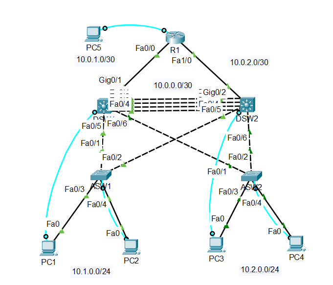

# Redundant Campus Network

A small redundant campus network I designed and built in Cisco Packet Tracer. It keeps working when one of the uplinks is cut, with no manual changes needed.

## Overview

My goal was to practice a proper three tier design: access switches at the bottom, multilayer distribution switches in the middle, and a router on top. I also wanted the network to survive a single uplink failure on its own. I tested this with traceroutes during a simulated link failure, and traffic moved to the backup path by itself.

## Topology

| Device | Role |
|---|---|
| ASW1 | Access switch for PC1 and PC2 (VLAN 10), trunks up to both DSWs |
| ASW2 | Access switch for PC3 and PC4 (VLAN 20), trunks up to both DSWs |
| DSW1, DSW2 | Multilayer distribution switches joined by a routed EtherChannel (Po1) |
| R1 | Core router with a link to each DSW and a loopback used as a test "remote network" |
| PC5 | Console machine for managing R1 out of band |

## IP Addressing

| Device | Interface | IP Address |
|---|---|---|
| R1 | Lo0 | 1.1.1.1/32 |
| R1 | Fa0/0 (to DSW1) | 10.0.1.2/30 |
| R1 | Fa1/0 (to DSW2) | 10.0.2.2/30 |
| DSW1 | Po1 | 10.0.0.1/30 |
| DSW1 | G0/1 (to R1) | 10.0.1.1/30 |
| DSW1 | VLAN 10 / VLAN 20 | 10.1.0.1/24, 10.2.0.1/24 |
| DSW2 | Po1 | 10.0.0.2/30 |
| DSW2 | G0/2 (to R1) | 10.0.2.1/30 |
| DSW2 | VLAN 10 / VLAN 20 | 10.1.0.2/24, 10.2.0.2/24 |
| HSRP gateway | VLAN 10 / VLAN 20 | 10.1.0.254, 10.2.0.254 |
| PCs | DHCP | .11 and up |

## How It Works

1. **Gateway redundancy (HSRP):** Each PC uses a virtual gateway (.254) instead of a specific switch, so the gateway stays up if one DSW fails. DSW1 is active for VLAN 10 and DSW2 is active for VLAN 20, so both switches carry traffic instead of one sitting idle.
2. **Uplink redundancy (floating static routes):** Each DSW has a main default route through its own link to R1, plus a backup route (AD 10) across the EtherChannel to the other DSW. R1 does the same for return traffic with backup routes at AD 5. No single uplink failure can cut off a VLAN.
3. **DHCP:** DSW1 hands out addresses for both VLANs, with .1 to .10 reserved. DHCP snooping is enabled on the access switches.

## Issues I Ran Into

1. **VLAN 10 lost connection after cutting DSW1's uplink.** DSW1 was still the active HSRP gateway, but its only route upstream was gone, so it quietly dropped all traffic. I fixed it by adding a floating static default route across the EtherChannel (`ip route 0.0.0.0 0.0.0.0 10.0.0.2 10`) and the same thing on DSW2.
2. **EtherChannel member ports were left shut down.** I brought up Po1 but forgot to `no shut` the physical ports on DSW2, so the link between the DSWs was dead. Now I always check with `show etherchannel summary`.
3. **Duplicate IPs on the HSRP SVIs.** I first gave both DSWs the same .1 address. Only the virtual IP should be shared. Packet Tracer showed a `%IP-4-DUPADDR` warning, and I changed DSW2 to .2.

## Results

1. VLAN 10 and VLAN 20 hosts can reach each other.
2. All PCs can reach R1 and its loopback (1.1.1.1).
3. With DSW1's uplink cut, VLAN 10 traffic automatically goes through DSW2. Traceroute shows the path going 10.1.0.1, then 10.1.0.2, then 1.1.1.1.
4. PCs get DHCP addresses from .11 up with .254 as their gateway.
5. `show standby` confirms DSW1 is active for VLAN 10 and DSW2 is active for VLAN 20.

## What I Learned

1. A redundant topology does not fail over by itself. Every device still needs a route for when its main path goes down.
2. HSRP protects the gateway, not the uplink.
3. Floating static routes are a simple way to get failover without a routing protocol.
4. Small mistakes like a missing `no shut` or a wrong IP can quietly break redundancy, so always check with show commands.

## Files

1. `Redundant Campus Network.pkt`: the Packet Tracer file
2. `Redundant Campus Network.pdf`: full project documentation
3. `configs/`: configuration commands for [ASW1](configs/ASW1.txt), [ASW2](configs/ASW2.txt), [DSW1](configs/DSW1.txt), [DSW2](configs/DSW2.txt), and [R1](configs/R1.txt)

## Tools

Cisco Packet Tracer
